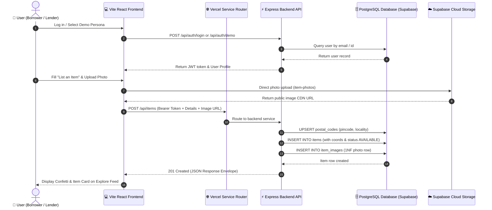

# ⚙️ RULES.md: Architecture, Tech Stack & Developer Guardrails

**Scope:** Architectural guidelines, technology standards, coding conventions, API contracts, and engineering guardrails for Rentu⁺.

---

## 1. Approved Technology Stack

### 1.1. Backend API Service
- **Runtime:** Node.js (v20+ LTS recommended, v18+ supported)
- **Language:** TypeScript (`strict: true`, target `ES2022`)
- **Web Framework:** Express.js 4.19+ (decoupled headless REST API)
- **Database Engine:** PostgreSQL 14+ (Hosted on Supabase with PostGIS extensions)
- **Database Driver & Pooling:** `pg` (node-postgres) with connection pooling targeting Supabase transaction pooler (port 6543)
- **Validation:** Zod 3.23+ (strict schema validation on all incoming query and body payloads)
- **Authentication:** Dual-mode authentication:
  - Standard JSON Web Tokens (`jsonwebtoken`, HMAC SHA256)
  - Firebase Authentication (`firebase-admin` token verification with local fallback)
- **Security:** `bcryptjs` password hashing, CORS whitelist protection
- **Bundler:** `esbuild` producing a standalone, self-contained `index.js` (only `--external:pg-native`)

### 1.2. Frontend Client Application
- **Framework:** React 18 + Vite 5 (Single Page Application)
- **Language:** TypeScript (`strict: true`)
- **Styling:** Tailwind CSS 3 (utility-first with customized neo-pop theme tokens and custom CSS variables)
- **Theme Engine:** Pure class-based dark mode (`dark` class on `<html>`) with instant `localStorage` persistence
- **Icons:** Lucide React (clean, lightweight SVG icons)
- **Visual Micro-Effects:** Canvas-Confetti on successful actions
- **Routing & State:** React hooks, Context API (`AuthContext`, `ThemeContext`), and zero external boilerplate

### 1.3. Cloud Infrastructure & Hosting
- **Hosting Platform:** Vercel Services (multi-service monorepo configuration)
  - `backend`: Express service (`root: "backend"`, entrypoint: `index.js`)
  - `frontend`: Vite SPA service (`root: "frontend"`, framework: `vite`)
- **Routing:** Public `/api/(.*)` paths routed cleanly to `{ "service": "backend" }`; all other routes serviced by `{ "service": "frontend" }`.
- **Object Storage:** Supabase Cloud Storage (`item-photos` public CDN bucket)

---

## 2. Solution Data Flow Diagram (DFD)



---

## 3. Directory & File Organization

```
Rento/
├── SPEC.md                  # Complete product specifications, personas & journeys
├── RULES.md                 # Engineering standards, tech stack & conventions
├── SCHEMA.md                # Normalized database architecture, ERD & DDL
├── ROADMAP.md               # Live milestone progress & future feature checklist
├── DESIGN.md                # Neo-pop pastel brutalist design tokens & layouts
├── README.md                # Project overview, setup instructions & quickstart
├── package.json             # Root monorepo scripts & workspaces
├── vercel.json              # Vercel Services multi-service configuration
├── supabase_setup.sql       # 1NF, 2NF, 3NF PostgreSQL DDL setup script
│
├── backend/                 # Decoupled Headless REST API
│   ├── src/
│   │   ├── config/          # PostgreSQL pool connection & environment variables
│   │   ├── db/              # Schema migration & realistic seed scripts
│   │   ├── middleware/      # JWT auth guard, response envelope, error handler
│   │   ├── modules/
│   │   │   ├── auth/        # Login, registration, demo auth & current user
│   │   │   ├── items/       # Rental listings CRUD, category & distance filter
│   │   │   ├── requests/    # Wanted board reverse bounties & fulfillment
│   │   │   ├── bookings/    # Rental proposals & handshake state machine
│   │   │   ├── messages/    # Coordination chat messages
│   │   │   ├── analytics/   # Hustle Hub metrics & leaderboards
│   │   │   └── users/       # User profiles, address & trust score updates
│   │   ├── utils/           # City extractor & distance formulas
│   │   ├── app.ts           # Express setup, CORS & route registration
│   │   └── server.ts        # Server entrypoint & port listener
│   ├── index.js             # Standalone self-contained bundled entrypoint (esbuild)
│   ├── package.json
│   └── tsconfig.json
│
└── frontend/                # Client Application (Vite + React SPA)
    ├── src/
    │   ├── components/      # UI components (Navbar, ItemCard, Modals, HustleHub)
    │   ├── lib/             # API client, AuthContext, ThemeContext, Types
    │   ├── styles/          # Tailwind globals & CSS custom properties
    │   ├── App.tsx          # Main view coordinator & state container
    │   └── main.tsx         # Root DOM mount with Providers
    ├── index.html           # HTML5 template with theme flash prevention
    ├── tailwind.config.js   # Tailwind design tokens & dark mode class config
    ├── vite.config.ts       # Vite configuration
    ├── package.json
    └── tsconfig.json
```

---

## 4. Coding Conventions & Standards

### 4.1. Standard API Response Structure
Every endpoint returns a consistent JSON envelope:

#### Success Response
```json
{
  "success": true,
  "data": {
    "id": "gear_c4a8b1",
    "title": "Sony Alpha 7 IV Mirrorless Camera",
    "price_per_day": 850,
    "status": "AVAILABLE"
  },
  "message": "Gear listed successfully! ✨ It is now live on the feed."
}
```

#### Error Response
```json
{
  "success": false,
  "error": {
    "code": "VALIDATION_ERROR",
    "message": "Input validation failed",
    "details": [
      {
        "field": "price_per_day",
        "message": "Price must be greater than 0"
      }
    ]
  }
}
```

### 4.2. Developer Guardrails & Strict Rules

1. **Git Branch Discipline:**
   - **NEVER** push, merge, or commit to `main` without explicit user permission.
   - All active development, testing, and deployment iterations must take place strictly on branch `testing`.

2. **100% Type Safety:**
   - Strict TypeScript everywhere. Do not introduce untyped `any`.
   - Maintain unified interface types in both backend (`src/modules/*`) and frontend (`src/lib/types.ts`).

3. **Input Validation on All Endpoints:**
   - Every `POST`, `PUT`, and `PATCH` endpoint must validate incoming payloads through strict Zod schemas before touching the database.

4. **1NF, 2NF, and 3NF Integrity Rules:**
   - When inserting an item or request with a postal code, **always** execute `INSERT INTO postal_codes (pincode, locality) VALUES (...) ON CONFLICT (pincode) DO NOTHING;` first to preserve foreign key constraints.
   - When creating an item with multiple photos, always insert photo URLs as individual rows in `item_images` table (1NF compliance).
   - Never store derived values in new tables (e.g., compute booking total prices dynamically from `(duration_days * price_per_day)`).

5. **Serverless Deployment Compatibility:**
   - Backend build script in `backend/package.json` must bundle dependencies directly into `backend/index.js` using `esbuild ... --external:pg-native` (omitting `--packages=external`) so the file runs standalone without external `node_modules` dependencies in Vercel containers.
   - In `backend/src/server.ts`, wrap `app.listen()` in `if (require.main === module && !process.env.VERCEL)` so the serverless wrapper executes smoothly without port collisions.
