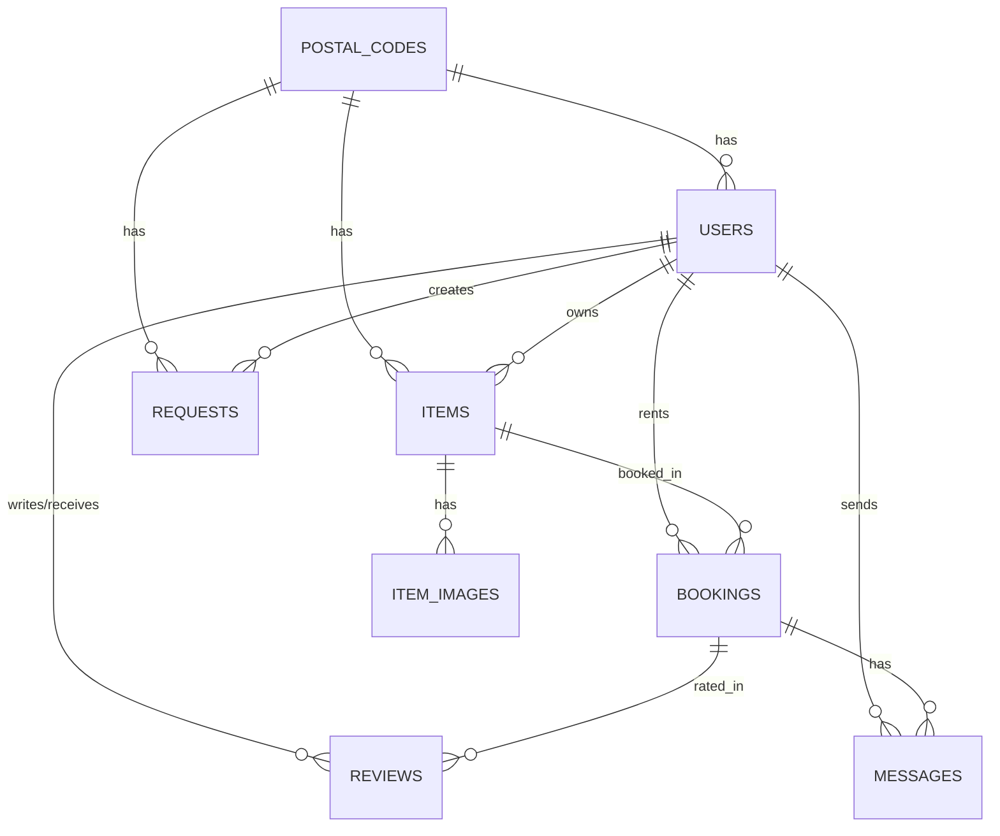

# SCHEMA.md: Database Architecture & Design

**Database:** PostgreSQL 14+ (Supabase)  
**Authentication:** Firebase Auth & JWT  
**Storage:** Supabase Storage (`item-photos` bucket)  
**Location:** GPS coordinates with PostGIS / Haversine distance calculations  
**Normalization:** 1NF, 2NF, and 3NF compliant  

---

## 1. Entity-Relationship Diagram (ERD)



---

## 2. Table Summary

| Table | Purpose | Primary Key | Key Foreign Keys |
| :--- | :--- | :--- | :--- |
| **postal_codes** | Pincode to locality mapping | `pincode` | - |
| **users** | User profiles, contact, GPS coordinates | `id` | `pincode` -> postal_codes |
| **items** | Gear listings with daily rental price | `id` | `owner_id` -> users, `pincode` -> postal_codes |
| **item_images** | Photos for item galleries (1NF) | `id` | `item_id` -> items |
| **requests** | Wanted gear bounties posted by borrowers | `id` | `seeker_id` -> users, `pincode` -> postal_codes |
| **bookings** | Rental reservations and proposals | `id` | `item_id` -> items, `borrower_id` -> users |
| **reviews** | Star ratings (1-5) and feedback | `id` | `booking_id` -> bookings, `reviewer_id` / `reviewee_id` -> users |
| **messages** | In-app chat messages for bookings | `id` | `booking_id` -> bookings, `sender_id` -> users |
| **notifications** | User alerts (booking updates, chats) | `id` | `user_id` -> users, `booking_id` -> bookings |
| **push_subscriptions** | Browser Web Push subscription tokens | `id` | `user_id` -> users |

---

## 3. Database Normalization (1NF, 2NF, 3NF)

### 1NF (Atomicity)
- **Item Photos:** Rather than saving photos inside an array or JSON blob in `items`, each photo is stored as its own row in `item_images (id, item_id, image_url, display_order)`.
- **Notifications:** Stored with clean individual columns (`sender_id`, `booking_id`, `message_id`) instead of unstructured JSON.

### 2NF (No Partial Key Dependencies)
- Every table uses a single primary key (`id` or `pincode`). Because there are no composite keys, every column depends entirely on the primary key.

### 3NF (No Transitive Dependencies)
- **Pincode & Locality:** Locality depends on pincode. We separated this into `postal_codes (pincode, locality, city, state)`. Users, items, and requests link to `pincode`.
- **Lender in Bookings:** A booking already links to an `item_id`, and that item already has an `owner_id`. Storing `lender_id` directly in `bookings` is redundant, so it is derived via joins or view `bookings_3nf_v`.
- **Total Price:** Total price equals days multiplied by daily rate. It is calculated dynamically in view `bookings_3nf_v`.
- **User Ratings:** Ratings and trust scores are aggregated dynamically from completed reviews and bookings in view `user_scores_3nf_v`.

---

## 4. Helper Views (3NF)

### Bookings View (`bookings_3nf_v`)
Calculates total price and resolves the lender automatically:
```sql
CREATE OR REPLACE VIEW bookings_3nf_v AS
SELECT 
    b.id,
    b.item_id,
    b.borrower_id,
    i.owner_id AS lender_id,
    b.start_date,
    b.start_time,
    b.duration_days,
    (b.duration_days * i.price_per_day) AS total_price,
    b.status,
    b.message,
    b.created_at
FROM bookings b
JOIN items i ON b.item_id = i.id;
```

### User Trust & Rating View (`user_scores_3nf_v`)
Calculates average ratings and trust scores on the fly:
```sql
CREATE OR REPLACE VIEW user_scores_3nf_v AS
SELECT 
    u.id AS user_id,
    ROUND(COALESCE(AVG(r.rating), 5.00), 2) AS rating,
    COUNT(r.id) AS review_count,
    LEAST(100, GREATEST(50, 70 + (COUNT(r.id) * 5) + (
        SELECT COUNT(*) FROM bookings b 
        JOIN items i ON b.item_id = i.id
        WHERE (b.borrower_id = u.id OR i.owner_id = u.id) AND b.status = 'COMPLETED'
    ) * 3)) AS trust_score
FROM users u
LEFT JOIN reviews r ON u.id = r.reviewee_id
GROUP BY u.id;
```

---

## 5. PostgreSQL Schema (DDL)

```sql
-- Enums
CREATE TYPE user_role AS ENUM ('USER', 'ADMIN');
CREATE TYPE item_status AS ENUM ('AVAILABLE', 'RENTED', 'UNAVAILABLE');
CREATE TYPE request_status AS ENUM ('OPEN', 'FULFILLED', 'CANCELLED');
CREATE TYPE booking_status AS ENUM ('PENDING', 'ACCEPTED', 'REJECTED', 'COMPLETED', 'CANCELLED');

-- 1. Postal Codes
CREATE TABLE postal_codes (
    pincode VARCHAR(10) PRIMARY KEY,
    locality VARCHAR(120) NOT NULL,
    city VARCHAR(120),
    state VARCHAR(120),
    created_at TIMESTAMP WITH TIME ZONE DEFAULT CURRENT_TIMESTAMP
);

-- 2. Users
CREATE TABLE users (
    id TEXT PRIMARY KEY,
    firebase_uid VARCHAR(255),
    name VARCHAR(120) NOT NULL,
    email VARCHAR(255) UNIQUE,
    phone VARCHAR(20),
    bio TEXT,
    avatar_url TEXT,
    banner_url TEXT,
    address_text TEXT,
    locality VARCHAR(120),
    pincode VARCHAR(10) REFERENCES postal_codes(pincode) ON DELETE SET NULL,
    latitude DOUBLE PRECISION,
    longitude DOUBLE PRECISION,
    rating NUMERIC(3, 2) DEFAULT 5.00,
    trust_score INT DEFAULT 98,
    role user_role DEFAULT 'USER',
    created_at TIMESTAMP WITH TIME ZONE DEFAULT CURRENT_TIMESTAMP,
    updated_at TIMESTAMP WITH TIME ZONE DEFAULT CURRENT_TIMESTAMP
);

-- 3. Items
CREATE TABLE items (
    id UUID PRIMARY KEY DEFAULT gen_random_uuid(),
    owner_id TEXT NOT NULL REFERENCES users(id) ON DELETE CASCADE,
    title VARCHAR(150) NOT NULL,
    description TEXT,
    category VARCHAR(60) NOT NULL,
    price_per_day NUMERIC(10, 2) NOT NULL CHECK (price_per_day >= 0),
    max_duration_days INTEGER DEFAULT 3 CHECK (max_duration_days > 0),
    image_urls JSONB DEFAULT '[]'::JSONB,
    sticker_badge VARCHAR(50) DEFAULT '✨ Weekend Flex',
    locality VARCHAR(120),
    address_text TEXT NOT NULL,
    pincode VARCHAR(10) REFERENCES postal_codes(pincode) ON DELETE SET NULL,
    latitude DOUBLE PRECISION NOT NULL,
    longitude DOUBLE PRECISION NOT NULL,
    status item_status DEFAULT 'AVAILABLE',
    created_at TIMESTAMP WITH TIME ZONE DEFAULT CURRENT_TIMESTAMP,
    updated_at TIMESTAMP WITH TIME ZONE DEFAULT CURRENT_TIMESTAMP
);

-- 4. Item Images (1NF)
CREATE TABLE item_images (
    id UUID PRIMARY KEY DEFAULT gen_random_uuid(),
    item_id UUID NOT NULL REFERENCES items(id) ON DELETE CASCADE,
    image_url TEXT NOT NULL,
    display_order INTEGER DEFAULT 0,
    created_at TIMESTAMP WITH TIME ZONE DEFAULT CURRENT_TIMESTAMP
);

-- 5. Requests (Wanted Board)
CREATE TABLE requests (
    id UUID PRIMARY KEY DEFAULT gen_random_uuid(),
    seeker_id TEXT NOT NULL REFERENCES users(id) ON DELETE CASCADE,
    item_name VARCHAR(150) NOT NULL,
    description TEXT,
    category VARCHAR(60),
    start_date DATE NOT NULL,
    start_time TIME,
    duration_days INTEGER NOT NULL DEFAULT 1 CHECK (duration_days > 0),
    offered_amount NUMERIC(10, 2) NOT NULL CHECK (offered_amount >= 0),
    locality VARCHAR(120),
    address_text TEXT NOT NULL,
    pincode VARCHAR(10) REFERENCES postal_codes(pincode) ON DELETE SET NULL,
    latitude DOUBLE PRECISION NOT NULL,
    longitude DOUBLE PRECISION NOT NULL,
    status request_status DEFAULT 'OPEN',
    created_at TIMESTAMP WITH TIME ZONE DEFAULT CURRENT_TIMESTAMP,
    updated_at TIMESTAMP WITH TIME ZONE DEFAULT CURRENT_TIMESTAMP
);

-- 6. Bookings
CREATE TABLE bookings (
    id UUID PRIMARY KEY DEFAULT gen_random_uuid(),
    item_id UUID NOT NULL REFERENCES items(id) ON DELETE RESTRICT,
    borrower_id TEXT NOT NULL REFERENCES users(id) ON DELETE RESTRICT,
    lender_id TEXT REFERENCES users(id) ON DELETE RESTRICT,
    start_date DATE NOT NULL,
    start_time TIME,
    duration_days INTEGER NOT NULL CHECK (duration_days > 0),
    total_price NUMERIC(10, 2) CHECK (total_price >= 0),
    status booking_status DEFAULT 'PENDING',
    message TEXT,
    created_at TIMESTAMP WITH TIME ZONE DEFAULT CURRENT_TIMESTAMP,
    updated_at TIMESTAMP WITH TIME ZONE DEFAULT CURRENT_TIMESTAMP
);

-- 7. Reviews
CREATE TABLE reviews (
    id UUID PRIMARY KEY DEFAULT gen_random_uuid(),
    booking_id UUID REFERENCES bookings(id) ON DELETE CASCADE,
    reviewer_id TEXT NOT NULL REFERENCES users(id) ON DELETE CASCADE,
    reviewee_id TEXT NOT NULL REFERENCES users(id) ON DELETE CASCADE,
    rating NUMERIC(3, 2) NOT NULL CHECK (rating >= 1.00 AND rating <= 5.00),
    comment TEXT,
    created_at TIMESTAMP WITH TIME ZONE DEFAULT CURRENT_TIMESTAMP
);

-- 8. Messages (Chat)
CREATE TABLE messages (
    id UUID PRIMARY KEY DEFAULT gen_random_uuid(),
    booking_id UUID REFERENCES bookings(id) ON DELETE CASCADE,
    sender_id TEXT NOT NULL REFERENCES users(id) ON DELETE CASCADE,
    receiver_id TEXT REFERENCES users(id) ON DELETE CASCADE,
    content TEXT NOT NULL,
    created_at TIMESTAMP WITH TIME ZONE DEFAULT CURRENT_TIMESTAMP
);

-- 9. Notifications
CREATE TABLE notifications (
    id UUID PRIMARY KEY DEFAULT gen_random_uuid(),
    user_id TEXT NOT NULL REFERENCES users(id) ON DELETE CASCADE,
    type VARCHAR(50) NOT NULL,
    title VARCHAR(150) NOT NULL,
    body TEXT NOT NULL,
    sender_id TEXT REFERENCES users(id) ON DELETE SET NULL,
    booking_id UUID REFERENCES bookings(id) ON DELETE SET NULL,
    message_id UUID REFERENCES messages(id) ON DELETE SET NULL,
    reference_id TEXT,
    reference_type VARCHAR(50),
    read_at TIMESTAMP WITH TIME ZONE,
    created_at TIMESTAMP WITH TIME ZONE DEFAULT CURRENT_TIMESTAMP
);

-- 10. Push Subscriptions
CREATE TABLE push_subscriptions (
    id UUID PRIMARY KEY DEFAULT gen_random_uuid(),
    user_id TEXT NOT NULL REFERENCES users(id) ON DELETE CASCADE,
    endpoint TEXT NOT NULL UNIQUE,
    p256dh TEXT NOT NULL,
    auth TEXT NOT NULL,
    created_at TIMESTAMP WITH TIME ZONE DEFAULT CURRENT_TIMESTAMP
);
```

---

## 6. Proximity Query (Haversine Distance)

Find items within 10 km of given coordinates `($1 = latitude, $2 = longitude)`:
```sql
SELECT 
    id, title, price_per_day, locality,
    ROUND((6371000 * acos(
        LEAST(1.0, GREATEST(-1.0, 
            cos(radians($1)) * cos(radians(latitude)) *
            cos(radians(longitude) - radians($2)) +
            sin(radians($1)) * sin(radians(latitude))
        ))
    ))::numeric / 1000, 2) AS distance_km
FROM items
WHERE status = 'AVAILABLE'
  AND (6371000 * acos(
      LEAST(1.0, GREATEST(-1.0, 
          cos(radians($1)) * cos(radians(latitude)) *
          cos(radians(longitude) - radians($2)) +
          sin(radians($1)) * sin(radians(latitude))
      ))
  )) <= 10000
ORDER BY distance_km ASC;
```
