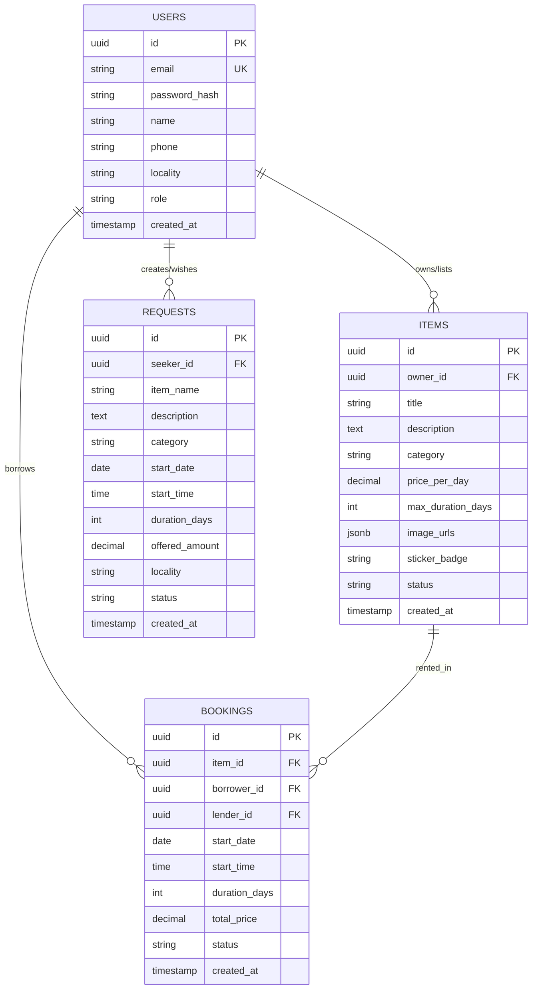

# 🗄️ SCHEMA.md: Database Tables, Types & SQL DDL

**Database Engine:** PostgreSQL (14+)  
**Version:** 1.0 (Core Engine + Community Analytics)

---

## 1. Entity-Relationship Overview



---

## 2. PostgreSQL DDL (Data Definition Language)

```sql
CREATE EXTENSION IF NOT EXISTS "uuid-ossp";

-- 1. USERS TABLE
CREATE TYPE user_role AS ENUM ('USER', 'ADMIN');

CREATE TABLE users (
    id UUID PRIMARY KEY DEFAULT uuid_generate_v4(),
    email VARCHAR(255) UNIQUE NOT NULL,
    password_hash VARCHAR(255) NOT NULL,
    name VARCHAR(100) NOT NULL,
    phone VARCHAR(20),
    locality VARCHAR(120),
    avatar_url TEXT,
    role user_role DEFAULT 'USER',
    created_at TIMESTAMP WITH TIME ZONE DEFAULT CURRENT_TIMESTAMP,
    updated_at TIMESTAMP WITH TIME ZONE DEFAULT CURRENT_TIMESTAMP
);

CREATE INDEX idx_users_email ON users(email);
CREATE INDEX idx_users_locality ON users(locality);
CREATE INDEX idx_users_role ON users(role);

-- 2. ITEMS (LISTINGS) TABLE
CREATE TYPE item_status AS ENUM ('AVAILABLE', 'RENTED', 'UNAVAILABLE');

CREATE TABLE items (
    id UUID PRIMARY KEY DEFAULT uuid_generate_v4(),
    owner_id UUID NOT NULL REFERENCES users(id) ON DELETE CASCADE,
    title VARCHAR(150) NOT NULL,
    description TEXT,
    category VARCHAR(60) NOT NULL,
    price_per_day NUMERIC(10, 2) NOT NULL CHECK (price_per_day >= 0),
    max_duration_days INTEGER DEFAULT 3 CHECK (max_duration_days > 0),
    image_urls JSONB DEFAULT '[]'::JSONB,
    sticker_badge VARCHAR(50) DEFAULT '✨ Weekend Flex',
    locality VARCHAR(120),
    status item_status DEFAULT 'AVAILABLE',
    created_at TIMESTAMP WITH TIME ZONE DEFAULT CURRENT_TIMESTAMP,
    updated_at TIMESTAMP WITH TIME ZONE DEFAULT CURRENT_TIMESTAMP
);

CREATE INDEX idx_items_owner ON items(owner_id);
CREATE INDEX idx_items_category ON items(category);
CREATE INDEX idx_items_status ON items(status);

-- 3. REQUESTS (COMMUNITY BOUNTIES) TABLE
CREATE TYPE request_status AS ENUM ('OPEN', 'FULFILLED', 'CANCELLED');

CREATE TABLE requests (
    id UUID PRIMARY KEY DEFAULT uuid_generate_v4(),
    seeker_id UUID NOT NULL REFERENCES users(id) ON DELETE CASCADE,
    item_name VARCHAR(150) NOT NULL,
    description TEXT,
    category VARCHAR(60),
    start_date DATE NOT NULL,
    start_time TIME,
    duration_days INTEGER NOT NULL DEFAULT 1 CHECK (duration_days > 0),
    offered_amount NUMERIC(10, 2) NOT NULL CHECK (offered_amount >= 0),
    locality VARCHAR(120),
    status request_status DEFAULT 'OPEN',
    created_at TIMESTAMP WITH TIME ZONE DEFAULT CURRENT_TIMESTAMP,
    updated_at TIMESTAMP WITH TIME ZONE DEFAULT CURRENT_TIMESTAMP
);

CREATE INDEX idx_requests_seeker ON requests(seeker_id);
CREATE INDEX idx_requests_status ON requests(status);
CREATE INDEX idx_requests_start_date ON requests(start_date);

-- 4. BOOKINGS (RENTAL PROPOSALS) TABLE
CREATE TYPE booking_status AS ENUM ('PENDING', 'ACCEPTED', 'REJECTED', 'COMPLETED', 'CANCELLED');

CREATE TABLE bookings (
    id UUID PRIMARY KEY DEFAULT uuid_generate_v4(),
    item_id UUID NOT NULL REFERENCES items(id) ON DELETE RESTRICT,
    borrower_id UUID NOT NULL REFERENCES users(id) ON DELETE RESTRICT,
    lender_id UUID NOT NULL REFERENCES users(id) ON DELETE RESTRICT,
    start_date DATE NOT NULL,
    start_time TIME,
    duration_days INTEGER NOT NULL CHECK (duration_days > 0),
    total_price NUMERIC(10, 2) NOT NULL CHECK (total_price >= 0),
    status booking_status DEFAULT 'PENDING',
    created_at TIMESTAMP WITH TIME ZONE DEFAULT CURRENT_TIMESTAMP,
    updated_at TIMESTAMP WITH TIME ZONE DEFAULT CURRENT_TIMESTAMP
);

CREATE INDEX idx_bookings_item ON bookings(item_id);
CREATE INDEX idx_bookings_borrower ON bookings(borrower_id);
CREATE INDEX idx_bookings_lender ON bookings(lender_id);
CREATE INDEX idx_bookings_status ON bookings(status);
```

---

## 3. Key Queries Reference (Including Community Pulse Analytics)

### Query 1: Browse Available Gear by Category & Search
```sql
SELECT i.id, i.title, i.category, i.price_per_day, i.max_duration_days, i.sticker_badge, i.image_urls, 
       u.name AS owner_name, u.locality AS owner_locality
FROM items i
JOIN users u ON i.owner_id = u.id
WHERE i.status = 'AVAILABLE'
  AND ($1::text IS NULL OR i.category = $1)
  AND ($2::text IS NULL OR i.title ILIKE '%' || $2 || '%')
ORDER BY i.created_at DESC;
```

### Query 2: Community Hustle & Pulse Analytics
```sql
SELECT 
    (SELECT COUNT(*) FROM users) AS total_users,
    (SELECT COUNT(DISTINCT owner_id) FROM items) AS active_lenders,
    (SELECT COUNT(DISTINCT borrower_id) FROM bookings) AS active_borrowers,
    (SELECT COUNT(*) FROM items WHERE status = 'AVAILABLE') AS available_gear,
    (SELECT COUNT(*) FROM items WHERE status = 'RENTED') AS currently_rented_gear,
    (SELECT COUNT(*) FROM bookings) AS total_bookings,
    (SELECT COUNT(*) FROM bookings WHERE status = 'COMPLETED') AS completed_bookings,
    (SELECT COALESCE(SUM(total_price), 0) FROM bookings WHERE status IN ('ACCEPTED', 'COMPLETED')) AS total_community_volume,
    (SELECT COUNT(*) FROM requests WHERE status = 'OPEN') AS open_wishes,
    (SELECT COUNT(*) FROM requests WHERE status = 'FULFILLED') AS fulfilled_wishes;
```
