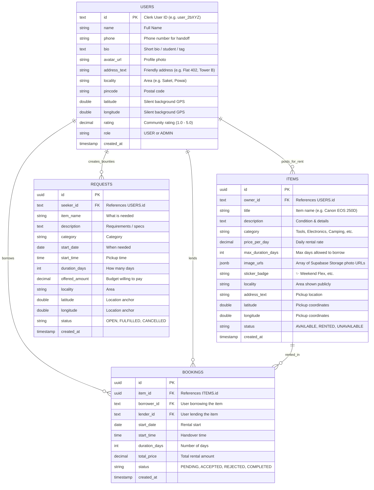

# 🗄️ SCHEMA.md: Database Tables, Supabase Storage & SQL DDL

**Database Engine:** PostgreSQL 14+ (Hosted on Supabase)  
**Auth Provider:** Clerk (User ID format: `user_2b...`, zero passwords stored in DB)  
**Storage Engine:** Supabase Storage (S3-compatible bucket for item photos)  
**Location Engine:** 100-Meter Proximity Radar (Haversine & PostGIS)

---

## 1. Entity-Relationship Overview



---

## 2. Complete PostgreSQL DDL (Ready for Supabase SQL Editor)

Copy and run this directly in the **Supabase SQL Editor**:

```sql
-- 1. ENABLE EXTENSIONS
CREATE EXTENSION IF NOT EXISTS "uuid-ossp";
CREATE EXTENSION IF NOT EXISTS "postgis"; -- For 100m proximity

-- 2. ENUM TYPES
CREATE TYPE user_role AS ENUM ('USER', 'ADMIN');
CREATE TYPE item_status AS ENUM ('AVAILABLE', 'RENTED', 'UNAVAILABLE');
CREATE TYPE request_status AS ENUM ('OPEN', 'FULFILLED', 'CANCELLED');
CREATE TYPE booking_status AS ENUM ('PENDING', 'ACCEPTED', 'REJECTED', 'COMPLETED', 'CANCELLED');

-- 3. USERS TABLE (Linked with Clerk via Clerk User ID)
-- Note: Email and password are kept securely inside Clerk.
CREATE TABLE users (
    id TEXT PRIMARY KEY,                 -- Clerk User ID (e.g. 'user_2bXYZ...')
    name VARCHAR(120) NOT NULL,          -- Synced from Clerk on signup
    phone VARCHAR(20),                   -- Contact number for pickup coordination
    bio TEXT,                            -- e.g. "Student • Photographer • Cat person"
    avatar_url TEXT,                     -- Synced from Clerk profile or uploaded
    address_text TEXT,                   -- Friendly address (e.g. "Tower 4, Green Valley Society")
    locality VARCHAR(120),               -- Locality (e.g. "Saket, South Delhi")
    pincode VARCHAR(10),                 -- Pincode
    latitude DOUBLE PRECISION,           -- Background GPS latitude for 100m radar
    longitude DOUBLE PRECISION,          -- Background GPS longitude for 100m radar
    rating NUMERIC(3, 2) DEFAULT 5.00,   -- Trust score (1.00 to 5.00)
    role user_role DEFAULT 'USER',       -- USER or ADMIN (for analytics)
    created_at TIMESTAMP WITH TIME ZONE DEFAULT CURRENT_TIMESTAMP,
    updated_at TIMESTAMP WITH TIME ZONE DEFAULT CURRENT_TIMESTAMP
);

CREATE INDEX idx_users_coords ON users(latitude, longitude);
CREATE INDEX idx_users_locality ON users(locality);

-- 4. ITEMS TABLE (Products posted for rent)
CREATE TABLE items (
    id UUID PRIMARY KEY DEFAULT uuid_generate_v4(),
    owner_id TEXT NOT NULL REFERENCES users(id) ON DELETE CASCADE,
    title VARCHAR(150) NOT NULL,
    description TEXT,
    category VARCHAR(60) NOT NULL,       -- 'Tools & DIY', 'Electronics', 'Camping', etc.
    price_per_day NUMERIC(10, 2) NOT NULL CHECK (price_per_day >= 0),
    max_duration_days INTEGER DEFAULT 3 CHECK (max_duration_days > 0),
    image_urls JSONB DEFAULT '[]'::JSONB,-- Array of Supabase Storage URLs (up to 8 photos)
    sticker_badge VARCHAR(50) DEFAULT '✨ Weekend Flex', -- Fun Gen Z tag
    locality VARCHAR(120),               -- Public area name
    address_text TEXT NOT NULL,          -- Friendly pickup address
    pincode VARCHAR(10),
    latitude DOUBLE PRECISION NOT NULL,  -- Pickup latitude
    longitude DOUBLE PRECISION NOT NULL, -- Pickup longitude
    status item_status DEFAULT 'AVAILABLE',
    created_at TIMESTAMP WITH TIME ZONE DEFAULT CURRENT_TIMESTAMP,
    updated_at TIMESTAMP WITH TIME ZONE DEFAULT CURRENT_TIMESTAMP
);

CREATE INDEX idx_items_owner ON items(owner_id);
CREATE INDEX idx_items_category ON items(category);
CREATE INDEX idx_items_status ON items(status);
CREATE INDEX idx_items_coords ON items(latitude, longitude);

-- 5. REQUESTS TABLE (Community Bounties / "Wanted to Rent")
CREATE TABLE requests (
    id UUID PRIMARY KEY DEFAULT uuid_generate_v4(),
    seeker_id TEXT NOT NULL REFERENCES users(id) ON DELETE CASCADE,
    item_name VARCHAR(150) NOT NULL,
    description TEXT,
    category VARCHAR(60),
    start_date DATE NOT NULL,
    start_time TIME,
    duration_days INTEGER NOT NULL DEFAULT 1 CHECK (duration_days > 0),
    offered_amount NUMERIC(10, 2) NOT NULL CHECK (offered_amount >= 0),
    locality VARCHAR(120),
    address_text TEXT NOT NULL,
    pincode VARCHAR(10),
    latitude DOUBLE PRECISION NOT NULL,
    longitude DOUBLE PRECISION NOT NULL,
    status request_status DEFAULT 'OPEN',
    created_at TIMESTAMP WITH TIME ZONE DEFAULT CURRENT_TIMESTAMP,
    updated_at TIMESTAMP WITH TIME ZONE DEFAULT CURRENT_TIMESTAMP
);

CREATE INDEX idx_requests_seeker ON requests(seeker_id);
CREATE INDEX idx_requests_status ON requests(status);
CREATE INDEX idx_requests_coords ON requests(latitude, longitude);

-- 6. BOOKINGS TABLE (Items rented / borrowed & transaction history)
CREATE TABLE bookings (
    id UUID PRIMARY KEY DEFAULT uuid_generate_v4(),
    item_id UUID NOT NULL REFERENCES items(id) ON DELETE RESTRICT,
    borrower_id TEXT NOT NULL REFERENCES users(id) ON DELETE RESTRICT,
    lender_id TEXT NOT NULL REFERENCES users(id) ON DELETE RESTRICT,
    start_date DATE NOT NULL,
    start_time TIME,
    duration_days INTEGER NOT NULL CHECK (duration_days > 0),
    total_price NUMERIC(10, 2) NOT NULL CHECK (total_price >= 0),
    status booking_status DEFAULT 'PENDING',
    created_at TIMESTAMP WITH TIME ZONE DEFAULT CURRENT_TIMESTAMP,
    updated_at TIMESTAMP WITH TIME ZONE DEFAULT CURRENT_TIMESTAMP
);

CREATE INDEX idx_bookings_item ON bookings(item_id);
CREATE INDEX idx_bookings_borrower ON bookings(borrower_id);
CREATE INDEX idx_bookings_lender ON bookings(lender_id);
CREATE INDEX idx_bookings_status ON bookings(status);
```

---

## 3. Supabase Storage Setup (For Photo Uploads)

Run this SQL snippet in Supabase to create the public bucket for item photos:

```sql
-- Create a public bucket for item photos
INSERT INTO storage.buckets (id, name, public) 
VALUES ('item-photos', 'item-photos', true)
ON CONFLICT (id) DO NOTHING;

-- Allow authenticated users to upload photos
CREATE POLICY "Allow authenticated uploads" 
ON storage.objects 
FOR INSERT 
TO authenticated 
WITH CHECK (bucket_id = 'item-photos');

-- Allow anyone to view item photos publicly
CREATE POLICY "Allow public image viewing" 
ON storage.objects 
FOR SELECT 
TO public 
USING (bucket_id = 'item-photos');
```

---

## 4. Key Production Queries

### Query 1: The 100-Meter Hyper-Local Radar (Find Gear Near Me)
Given the user's location (`$1 = latitude`, `$2 = longitude`), returns items within 100 meters, sorted by distance:
```sql
SELECT 
    i.id, 
    i.title, 
    i.category, 
    i.price_per_day, 
    i.sticker_badge,
    i.image_urls,
    u.name AS owner_name,
    u.avatar_url AS owner_avatar,
    u.locality AS owner_locality,
    ROUND(
        6371000 * acos(
            LEAST(1.0, GREATEST(-1.0, 
                cos(radians($1)) * cos(radians(i.latitude)) *
                cos(radians(i.longitude) - radians($2)) +
                sin(radians($1)) * sin(radians(i.latitude))
            ))
        )
    ) AS distance_meters
FROM items i
JOIN users u ON i.owner_id = u.id
WHERE i.status = 'AVAILABLE'
  AND (
      6371000 * acos(
          LEAST(1.0, GREATEST(-1.0, 
              cos(radians($1)) * cos(radians(i.latitude)) *
              cos(radians(i.longitude) - radians($2)) +
              sin(radians($1)) * sin(radians(i.latitude))
          ))
      )
  ) <= 100 -- 100 meters filter
ORDER BY distance_meters ASC;
```

### Query 2: "My Profile" Overview (What I'm Lending & What I've Rented)
```sql
-- 1. All gear listed by this user (My Listings)
SELECT * FROM items 
WHERE owner_id = :clerk_user_id 
ORDER BY created_at DESC;

-- 2. Items this user has borrowed / taken as rent (My Borrows)
SELECT b.id AS booking_id, b.start_date, b.duration_days, b.total_price, b.status,
       i.title AS item_title, i.image_urls, u.name AS lender_name, u.phone AS lender_phone
FROM bookings b
JOIN items i ON b.item_id = i.id
JOIN users u ON b.lender_id = u.id
WHERE b.borrower_id = :clerk_user_id
ORDER BY b.created_at DESC;

-- 3. Rental requests sent to this user for their gear (Incoming Proposals)
SELECT b.id AS booking_id, b.start_date, b.duration_days, b.total_price, b.status,
       i.title AS item_title, u.name AS borrower_name, u.avatar_url AS borrower_avatar
FROM bookings b
JOIN items i ON b.item_id = i.id
JOIN users u ON b.borrower_id = u.id
WHERE b.lender_id = :clerk_user_id
ORDER BY b.created_at DESC;
```

### Query 3: Community & Domain Analytics
```sql
SELECT 
    (SELECT COUNT(*) FROM users) AS total_users,
    (SELECT COUNT(DISTINCT owner_id) FROM items) AS active_lenders,
    (SELECT COUNT(DISTINCT borrower_id) FROM bookings) AS active_borrowers,
    (SELECT COUNT(*) FROM items WHERE status = 'AVAILABLE') AS available_gear,
    (SELECT COUNT(*) FROM items WHERE status = 'RENTED') AS currently_rented_gear,
    (SELECT COUNT(*) FROM bookings WHERE status = 'COMPLETED') AS completed_rentals,
    (SELECT COALESCE(SUM(total_price), 0) FROM bookings WHERE status IN ('ACCEPTED', 'COMPLETED')) AS total_volume_rupees,
    (SELECT COUNT(*) FROM requests WHERE status = 'OPEN') AS open_wishes;
```

---

## 5. TypeScript Interface Definitions

```typescript
export interface UserProfile {
  id: string; // Clerk User ID
  name: string;
  phone?: string | null;
  bio?: string | null;
  avatarUrl?: string | null;
  addressText?: string | null;
  locality?: string | null;
  pincode?: string | null;
  latitude?: number | null;
  longitude?: number | null;
  rating: number;
  role: 'USER' | 'ADMIN';
  createdAt: string;
}

export interface ItemListing {
  id: string;
  ownerId: string;
  title: string;
  description: string;
  category: string;
  pricePerDay: number;
  maxDurationDays: number;
  imageUrls: string[]; // URLs from Supabase Storage
  stickerBadge: string;
  locality: string;
  addressText: string;
  pincode?: string;
  latitude: number;
  longitude: number;
  status: 'AVAILABLE' | 'RENTED' | 'UNAVAILABLE';
  createdAt: string;
}

export interface BookingRecord {
  id: string;
  itemId: string;
  borrowerId: string;
  lenderId: string;
  startDate: string;
  startTime?: string | null;
  durationDays: number;
  totalPrice: number;
  status: 'PENDING' | 'ACCEPTED' | 'REJECTED' | 'COMPLETED' | 'CANCELLED';
  createdAt: string;
}

export interface CommunityBounty {
  id: string;
  seekerId: string;
  itemName: string;
  description: string;
  category: string;
  startDate: string;
  startTime?: string | null;
  durationDays: number;
  offeredAmount: number;
  locality: string;
  addressText: string;
  latitude: number;
  longitude: number;
  status: 'OPEN' | 'FULFILLED' | 'CANCELLED';
  createdAt: string;
}
```
