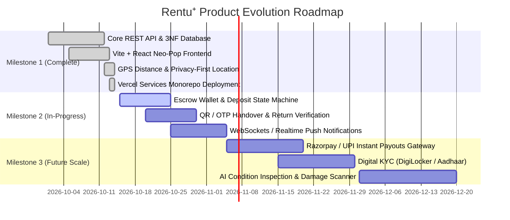
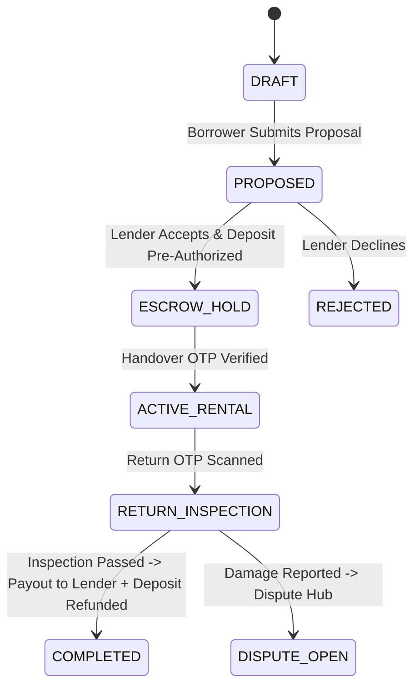

# ⚡ SPEC.md: Product Specification & System Architecture

**Product Name:** Rentu⁺ (Gen Z Peer-to-Peer Gear Sharing & Rental Platform)  
**Motto:** *"Don't buy it. Rent it. Flex it."*  
**Secondary Tagline:** *"Same stuff. More people. Happier planet. Good things circulate."*  
**Target Audience:** Gen Z college students, digital creators, young professionals, flatmates, and outdoor adventurers.  
**Core Vibe:** Fast, trendy, anti-hoarding, community-first. Makes renting gear feel like a badge of honor and a smart flex rather than a financial compromise.

---

## 1. Product Overview & Gen Z Mindset

### The Psychology of Anti-Ownership
Gen Z prioritizes **access and experiences over burdensome physical ownership**. Spending ₹60,000 on a high-end camera, ₹15,000 on a DJ console, or ₹8,000 on a camping tent that gathers dust for 50 weeks a year is outdated.
- **For Borrowers / Renters:** Instant access to premium tools, tech, streetwear, and gear on-demand at a fraction of retail cost—cheaper than a round of iced boba.
- **For Lenders / Hustlers:** Monetize idle gear chilling in bedrooms and closets, turning dormant assets into recurring passive income (secure the bag 💸).
- **Core Marketplace Principle:** Dual-sided liquidity engine pairing a supply-driven **Available Gear Feed** with a demand-driven **Wanted Board (Reverse Bounties)**.

---

## 2. Technology Stack & Infrastructure

| Layer | Technologies & Frameworks | Purpose & Implementation |
| :--- | :--- | :--- |
| **Frontend Framework** | **React 18** + **Vite 5** | Blazing-fast client SPA with instantaneous HMR and optimized asset bundling |
| **Styling & Design System** | **Tailwind CSS 3** + **Vanilla CSS Variables** | Neo-Pop & Pastel Brutalism design tokens with full class-based Dark/Light theme engine |
| **Typography & Icons** | **Plus Jakarta Sans**, **Inter**, **Lucide React** | High-contrast modern typography hierarchy and lightweight SVG iconography |
| **State Management** | **React Hooks** + **Custom Contexts** | `AuthContext` (JWT/Firebase), `ThemeContext` (Dark/Light), local optimistic state |
| **Backend REST API** | **Node.js (v20+ LTS)** + **Express.js** + **TypeScript** | Decoupled, type-safe RESTful API with standardized response envelopes |
| **Validation Engine** | **Zod** | Strict schema validation on all API input parameters and request bodies |
| **Relational Database** | **PostgreSQL 14+** (Supabase Managed / AWS Pooler) | 100% 1NF, 2NF, 3NF compliant normalized relational storage with PostGIS extensions |
| **Connection Pooling** | **`pg` (node-postgres)** + **PgBouncer** (Port 6543) | Resilient transaction-mode connection pooling optimized for serverless executions |
| **Authentication** | **JWT (JSON Web Tokens)** + **Firebase Admin SDK** | Dual-mode token verification supporting local HMAC tokens and Firebase Auth UIDs |
| **Cloud Storage** | **Supabase Storage** (`item-photos` public bucket) | Secure object storage for multi-photo gear listings and user avatars |
| **Build & Bundler** | **esbuild** (Node.js target, standalone bundle) | Single self-contained `index.js` deployment bundle with zero runtime dependency leaks |
| **Deployment Platform** | **Vercel Services** | Multi-service atomic monorepo hosting (`frontend` Vite + `backend` Express service) |

---

## 3. System Architecture & Data Flow Diagrams

### 3.1. High-Level Context Diagram (DFD Level 0)

```mermaid
graph TD
    User["👤 User (Borrower / Lender / Admin)"]
    Frontend["💻 Rentu⁺ Client (Vite + React SPA)"]
    Gateway["🌐 Vercel Edge / API Router (/api/*)"]
    Backend["⚡ Rentu⁺ REST Service (Express + TypeScript)"]
    DB[("🗄️ PostgreSQL (Supabase 3NF Database)")]
    AuthServer["🔐 Firebase / Supabase Auth Service"]
    Storage["☁️ Supabase Cloud Storage (Item Photos)"]

    User <-->|Browses, Lists, Rents, Chats| Frontend
    Frontend <-->|Direct Auth & Token Exchange| AuthServer
    Frontend <-->|Direct Photo Uploads| Storage
    Frontend <-->|REST API Calls (Bearer JWT)| Gateway
    Gateway <-->|Internal Service Routing| Backend
    Backend <-->|SQL Queries & Relational Views| DB
    Backend <-->|Verify ID Tokens| AuthServer
```

### 3.2. Detailed Data Flow Diagram (DFD Level 1)

```mermaid
flowchart TD
    subgraph ClientLayer["🖥️ Frontend Client Application"]
        A1["Explore & Search View"]
        A2["Drop Gear Modal (Lender)"]
        A3["Wanted Board Modal (Borrower)"]
        A4["Rental Proposal Modal"]
        A5["Direct Peer Chat"]
        A6["Profile & GPS Coordinates"]
    end

    subgraph APILayer["⚡ Express API Service (Backend)"]
        B1["Auth Middleware (JWT/Firebase)"]
        B2["/api/items (Gear Listings)"]
        B3["/api/requests (Wanted Bounties)"]
        B4["/api/bookings (Handshake Lifecycle)"]
        B5["/api/messages (Coordination Chat)"]
        B6["/api/users (Profile & GPS Radar)"]
        B7["/api/analytics (Hustle Hub Overview)"]
    end

    subgraph DBLayer["🗄️ PostgreSQL 3NF Schema & Views"]
        C1[("postal_codes")]
        C2[("users")]
        C3[("items & item_images")]
        C4[("requests")]
        C5[("bookings")]
        C6[("messages")]
        C7[("reviews")]
        C8[("3NF Views: user_scores_3nf_v, bookings_3nf_v")]
    end

    A6 -->|1-Click GPS| B6
    B6 -->|Upsert Coordinates & Pincode| C1
    B6 -->|Update Location| C2

    A2 -->|Create Listing| B2
    B1 -.->|Authorize| B2
    B2 -->|Insert Item & Images| C3
    B2 -->|Link Postal Code| C1

    A3 -->|Post Bounty| B3
    B1 -.->|Authorize| B3
    B3 -->|Insert Request| C4

    A4 -->|Propose Booking| B4
    B1 -.->|Authorize| B4
    B4 -->|Insert Booking (PENDING)| C5

    A5 -->|Send Message| B5
    B1 -.->|Authorize| B5
    B5 -->|Insert Chat Message| C6

    B7 -->|Aggregate Volume & Active Users| C8
    B7 -->|Read Leaderboards| C3
```

---

## 4. Current Features (Implemented Up Until Now)

### 4.1. Privacy-First Profile Location & GPS Distance Tracking
- **Zero Location Clutter:** All public navigation headers, search inputs, and page titles are completely stripped of hardcoded city names.
- **1-Click GPS Auto-Detection:** Users configure their location strictly inside their private Profile modal (`EditProfileModal`) using the HTML5 Geolocation API and OpenStreetMap Nominatim reverse-geocoding.
- **Discrete Structured Address:** Captures Building / House / Flat No., Street / Road / Landmark, Locality / Neighborhood, and Postal PIN code.
- **Silent Background GPS Radar:** Latitudes and longitudes are captured silently and indexed in PostgreSQL (`idx_users_coords`, `idx_items_coords`) to compute real-time Haversine proximity formulas without ever leaking building addresses publicly.

### 4.2. Complete Dark & Light Theme Engine
- **Animated Theme Toggle:** Instant sun/moon toggle switch (`#theme-toggle-btn`) in the top navigation bar.
- **Dual Design Token Palette:**
  - *Light Mode:* Warm off-white canvas (`#FAFAFA`), crisp white cards (`#FFFFFF`), subtle dividers (`#E5E7EB`), and charcoal ink (`#111827`).
  - *Dark Mode:* Deep midnight charcoal (`#0F1015`), elevated dark surfaces (`#171821`), charcoal borders (`#262734`), and bright text (`#F9FAFB`).
- **Zero Flash of Unstyled Theme (FOUT):** Synchronous inline script in `index.html` resolves `localStorage` or `prefers-color-scheme` before DOM rendering.

### 4.3. Dual Marketplace Feeds (Supply & Demand)
- **Supply Marketplace ("Explore Gear"):**
  - Category filters (`Tools & DIY`, `Electronics & Tech`, `Camping & Outdoor`, `Home & Living`, `Clothing & Fits`, `Books`, `Sports`).
  - Real-time search by keyword, title, category, or locality.
  - Price display per day (`₹/day`), availability indicator (`AVAILABLE` vs `RENTED`), and Gen Z sticker badges (*✨ Weekend Flex*, *💸 Certified Steal*).
- **Demand Marketplace ("Wanted Board / Community Wishes"):**
  - Reverse rental marketplace for unmet gear needs.
  - Seeker specifies item name, category, needed start date, duration (days), and offered budget (₹).
  - Reverse fulfillment: Any nearby owner can tap **"I can lend this ⚡"** to instantly claim and satisfy the bounty.

### 4.4. 30-Second Fast Gear Drop ("List an Item")
- 4-step wizard:
  1. *Item Details:* Title, category selection, and description.
  2. *Pricing & Availability:* Daily rate (₹/day), maximum rental duration, and optional free community lending flag.
  3. *Photos:* Direct image upload or image URL input with live preview.
  4. *Review & Publish:* Summary review before instant insertion into `items` and 1NF `item_images` tables.

### 4.5. Booking Proposal & Handshake Flow
- Renter selects dates and duration on the item detail view.
- Real-time price estimation ($(\text{duration} \times \text{price\_per\_day})$).
- Lender receives proposal with status: `PENDING` $\to$ `ACCEPTED` / `REJECTED` $\to$ `COMPLETED`.

### 4.6. Direct Coordination Chat
- Split-screen in-app messaging interface tied to booking reservations.
- Real-time message exchange between borrower and lender for coordinate meetup, handover instructions, and item condition verification.

### 4.7. Community Analytics ("Hustle Hub")
- Domain metrics dashboard displaying:
  - Total community transacted volume (₹ earned and saved).
  - Active lenders vs. active borrowers ratio.
  - Category popularity leaderboards and trending gear demand.

### 4.8. 1-Click Instant Persona Switcher
- Pre-seeded realistic demo profiles for rapid testing:
  - 📸 **Rohit Verma (Lender):** Delhi — Sony Alpha 7 IV, Camping Tent, Drill Set.
  - 🎨 **Ananya Roy (Renter):** Bangalore — Fujifilm X-T30, Vintage Camcorder, Streetwear.
  - 👑 **Aarav Mehta (Admin):** Mumbai — Pioneer DJ Controller, Analytics Lead.

### 4.9. 100% 1NF, 2NF, and 3NF Relational Database
- Complete elimination of multi-valued photo JSON arrays via atomic child table `item_images`.
- Normalization of postal boundaries via `postal_codes (pincode PK, locality, city, state)`.
- Removal of transitive redundancies via views `bookings_3nf_v`, `user_scores_3nf_v`, and `messages_3nf_v`.

### 4.10. Vercel Services Standalone Monorepo Architecture
- Zero-leak build pipeline using `esbuild` bundling all runtime packages (`express`, `pg`, `zod`, `cors`, `jsonwebtoken`, `bcryptjs`) into a self-contained 3MB bundle.
- Eliminates serverless `MODULE_NOT_FOUND` runtime crashes.

---

## 5. Future Features & Roadmap Specifications



### 5.1. Milestone 2: Trust, Safety & Escrow State Machine

#### A. Automated Escrow Deposit Locking
- **The Problem:** Peer renting expensive items (e.g. ₹80,000 camera) creates anxiety for lenders regarding item theft or damage.
- **The Solution:** An automated escrow state machine:
  $$\text{Total Authorized Hold} = (\text{Daily Rate} \times \text{Days}) + \text{Security Deposit}$$
- The rental fee is held in escrow upon booking acceptance. The refundable security deposit is pre-authorized on the borrower's card or UPI handle and released automatically upon clean return.



#### B. Handover & Return OTP / QR Verification
- When borrower and lender meet for gear handoff:
  - Lender’s app generates a one-time 4-digit Handover PIN or dynamic QR code.
  - Borrower enters the PIN into their app to certify that the gear was received in described condition.
  - This transitions the booking from `ESCROW_HOLD` to `ACTIVE_RENTAL`.
- On return, the reverse occurs to release the security deposit.

#### C. Real-time WebSockets & Push Notifications
- Integration of Supabase Realtime or Socket.io for instant chat delivery without polling.
- Web Push API (`push_subscriptions` table) and Firebase Cloud Messaging (FCM) for mobile and desktop notification alerts on new bookings, proposals, and chat messages.

---

### 5.2. Milestone 3: Commercial Scaling, Payments & AI Verification

#### A. Automated Payment Gateway & Instant UPI Payouts
- Direct integration with **Razorpay Route** or **Cashfree Split Payments**.
- Platform fee (e.g., 8–10%) automatically deducted at settlement.
- Instant automated UPI payouts directly to the lender's bank account upon return signoff.

#### B. Digital KYC & Verification Badges
- Integration with **DigiLocker / Aadhaar XML / Stripe Identity** for 1-minute government ID verification.
- Verified users receive a blue shield badge (*🛡️ Verified Campus Member*), unlocking high-tier gear listings without requiring excessive security deposits.

#### C. AI Equipment Damage Scanner & Price Recommender
- **Visual Condition Inspector:** Borrower and lender take 4 photos at handover. Computer vision compares handover photos with return photos to highlight new scratches, cracks, or dents.
- **Dynamic Price Engine:** Recommends optimal rental rates based on item age, retail value, and local demand density.

---

## 6. End-to-End User Journeys

### Journey 1: Gear Drop (Lender Monetization Flow)
```
[User Logged In] ──► [Tap "+ Post" -> "List an Item"]
       │
       ▼
[Enter Gear Name, Category, ₹/day, Max Duration, Locality]
       │
       ▼
[Attach High-Res Photos -> Upload to Supabase Storage]
       │
       ▼
[Publish Item] ──► [Instant Card with Sticker Badge on Explore Feed]
```

### Journey 2: The Weekend Snag (Borrower Flow)
```
[Browse Explore Feed / Search Gear]
       │
       ▼
[Select Item -> View Details, Price per Day, Owner Trust Score]
       │
       ▼
[Select Rental Dates -> View Dynamic Price Calculation]
       │
       ▼
[Submit Proposal] ──► [Lender Receives Notification]
       │
       ▼
[Lender Taps "Accept"] ──► [Chat Unlocked -> Handover Coordination]
```

### Journey 3: The Community Wish (Reverse Bounty Flow)
```
[User Needs Gear Not Currently Listed in Marketplace]
       │
       ▼
[Tap "+ Post" -> "Post a Request"]
       │
       ▼
[State Gear Name, Category, Needed Dates, Offered Budget (₹)]
       │
       ▼
[Published to Wanted Board Feed]
       │
       ▼
[Neighbor Sees Bounty -> Taps "I can lend this ⚡" -> Match Confirmed]
```
