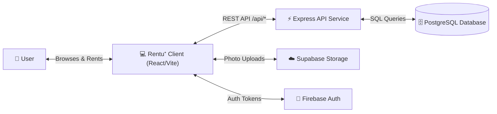
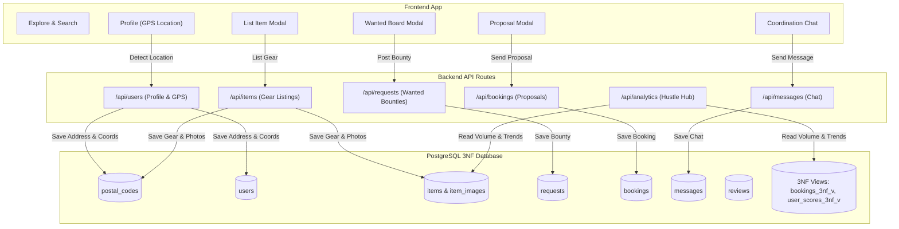

# SPEC.md: Product Specification & System Architecture

**Product Name:** Rentu⁺  
**Motto:** *"Don't buy it. Rent it. Flex it."*  
**Audience:** Gen Z students, creators, flatmates, and young professionals.  
**Core Concept:** Peer-to-peer gear rentals. Rent what you need for short periods; list idle gear to earn passive income.

---

## 1. Product Overview

Rentu⁺ is built around the idea of access over ownership:
- **For Borrowers:** Rent high-value items (cameras, projectors, consoles, camping gear, tools) nearby at low daily rates.
- **For Lenders:** Earn money from gear sitting unused at home.
- **Dual Marketplace:**
  - **Explore Feed (Supply):** Browse available items listed by neighbors.
  - **Wanted Board (Demand):** Post what you need and what you are willing to pay; nearby owners claim the request.

---

## 2. Technology Stack

| Layer | Framework / Tool | Purpose |
| :--- | :--- | :--- |
| **Frontend** | React 18 + Vite 5 | Fast Single Page App (SPA) |
| **Styling** | Tailwind CSS 3 | Modern Neo-Pop styling with dark/light mode |
| **Icons** | Lucide React | Clean, lightweight SVG icons |
| **Backend API** | Node.js + Express.js + TypeScript | Decoupled REST API |
| **Validation** | Zod | Input validation on all endpoints |
| **Database** | PostgreSQL 14+ (Supabase) | Normalized 3NF relational storage |
| **Spatial Engine** | PostGIS & Haversine | Distance matching without exposing exact addresses |
| **Authentication** | JWT + Firebase Admin | Secure tokens and 1-click demo login |
| **Storage** | Supabase Storage | Image uploads for gear photos |
| **Deployment** | Vercel Services | Multi-service hosting (`frontend` + `backend`) |

---

## 3. System Architecture & Data Flow

### 3.1. High-Level Flow (DFD Level 0)



### 3.2. Detailed Data Flow (DFD Level 1)



---

## 4. Current Features (Implemented)

### 4.1. Privacy-First Location & GPS Distance
- **No Public Location Spam:** City names are removed from navigation and search bars.
- **1-Click GPS in Profile:** Users set location inside their Profile modal. Browser Geolocation auto-fills building, street, locality, and PIN code.
- **Silent Distance Tracking:** GPS coordinates (`latitude`, `longitude`) compute real-time distance (`X km away`) without displaying private house numbers publicly.

### 4.2. Dark Mode & Light Mode
- Clean Sun/Moon toggle button in the navbar.
- High-contrast dark palette (`#0F1015`) and clean light palette (`#FAFAFA`).
- Remembers user preference in `localStorage` with zero flash on reload.

### 4.3. Dual Marketplace Feeds
- **Available Gear:** Search by category (`Tools`, `Tech`, `Camping`, `Home`, `Fits`, `Sports`), keyword, or price.
- **Wanted Board:** Post gear requests with needed dates and offered budget. Nearby neighbors click **"I can lend this ⚡"** to claim and fulfill.

### 4.4. 30-Second Fast Gear Drop
- 4-step wizard:
  1. *Details:* Title, category, description.
  2. *Pricing:* Daily rate (₹/day), maximum rental duration.
  3. *Photos:* Image upload with preview.
  4. *Review:* One-click publish.

### 4.5. Booking Proposals & Handshake
- Renter selects dates; the app calculates total cost automatically.
- Proposal status lifecycle: `PENDING` -> `ACCEPTED` / `REJECTED` -> `COMPLETED`.

### 4.6. Direct Coordination Chat
- Split-screen messaging tied to active bookings for coordinating handoff and return.

### 4.7. Hustle Hub (Community Analytics)
- Dashboard displaying total rental volume (₹), active lenders vs. borrowers, and top gear categories.

### 4.8. 1-Click Demo Profiles
- Instantly test different personas without typing credentials:
  - **Rohit Verma (Lender):** Delhi — Camera, camping tent, drills.
  - **Ananya Roy (Renter):** Bangalore — Vintage camcorder, streetwear.
  - **Aarav Mehta (Admin):** Mumbai — DJ controller, analytics.

### 4.9. 3NF Database Normalization
- Photos stored cleanly in `item_images` (1NF).
- Pincodes separated into `postal_codes` (3NF).
- Totals and ratings calculated dynamically via database views (`bookings_3nf_v`, `user_scores_3nf_v`).

### 4.10. Vercel Deployment
- Built with standalone `esbuild` bundling so the serverless function runs reliably without missing module errors.

---

## 5. Future Features & Roadmap

### Milestone 2: Escrow, Safety & Verification (In Progress)
1. **Automated Escrow & Deposit Hold:**
   - Total Authorized Hold = (Daily Rate × Days) + Security Deposit.
   - Rental fee held in escrow; security deposit pre-authorized and released automatically on clean return.
2. **Handover & Return OTP / QR Codes:**
   - 4-digit code generated on lender's phone.
   - Borrower enters code on meetup to confirm receipt and condition, locking custody.
3. **Real-Time Chat & Push Notifications:**
   - Instant messaging updates without manual refresh.
   - Mobile and browser push notifications for booking alerts.

### Milestone 3: Payments & Scaling (Planned)
1. **UPI & Card Payment Gateway:**
   - Razorpay / Cashfree integration with automated split payouts directly to lenders.
2. **Digital Student & ID KYC:**
   - DigiLocker / Aadhaar verification badges for lower deposit requirements.
3. **AI Damage Inspection:**
   - Computer vision compares before/after photos to flag new scratches or damage.

---

## 6. User Journeys

### Journey 1: Listing Gear (Lender)
```
[Logged In] -> [Tap "+ Post" -> "List an Item"]
            -> [Fill Title, Category, ₹/day, Max Days]
            -> [Attach Photos]
            -> [Publish -> Live on Explore Feed]
```

### Journey 2: Renting Gear (Borrower)
```
[Browse Feed] -> [Select Gear -> View Daily Rate & Distance]
              -> [Pick Dates -> View Total Cost]
              -> [Send Proposal -> Lender Accepts]
              -> [Chat Opens -> Coordinate Meetup]
```

### Journey 3: Posting a Bounty (Wanted Board)
```
[Need Unlisted Gear] -> [Tap "+ Post" -> "Post a Request"]
                     -> [Enter Item Name, Needed Dates, Budget]
                     -> [Published to Wanted Board]
                     -> [Neighbor Sees Request -> Clicks "I can lend this ⚡"]
```
